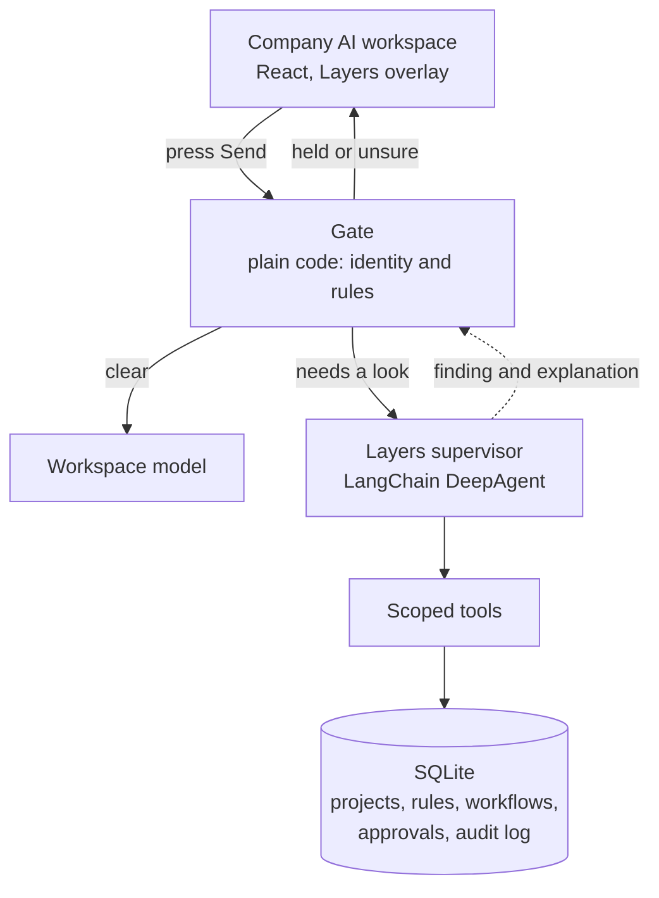

# Layers

An intelligent management layer for a company's AI workspace. AI does the work; Layers manages the work.

Built at HackPrinceton, November 13 to 15, 2026. Track: Business and Enterprise.

## What it does

An employee works in the company's AI chat. Layers checks each prompt when they press Send:

- **On project:** it goes straight through, and Layers stays quiet.
- **Off project:** it is held. Layers names the rule, shows the words that triggered it, and offers a way back or a request to the manager.
- **Already built:** if the team has an approved workflow for the request, Layers offers it and, on a click, applies it to the project. Two are set up for this project: a competitor comparison sheet and a presentation outline. Each moves its own task along.
- **Not sure:** Layers says so, shows what counted each way, and follows the company's choice: ask the employee, let it through and log it, or hand it to a person.

- **Branches:** when the conversation moves to a different part of the project, Layers gives that direction its own line without being asked (an implicit branch). When the employee keeps coming back to the same direction, Layers moves it into a chat of its own (an explicit branch), listed under the chat it came from, and says so with a one-key undo. One return is enough when that direction is a third of the chat or more; a small aside has to grow to three prompts or be returned to twice. Layers shows the numbers it went on. The employee can also start a chat from any earlier prompt, merge lines back one at a time or all at once, and put a chat back where it came from. Each chat only gives the model its own history plus what it shared before it split.
- **The branch map:** right-click the agent, or use the Branches button, for a page that draws the conversation: one row per line, one dot per prompt, a number where the employee came back to a line, and a zigzag for a long unbroken run. A second tab, "Today so far", reads progress from the branches and the task list.
- **The manager's view** (`#manager`): approval requests with the reason and the words that triggered them, the rules, the team, then one person at a time with their activity, task progress and branch map.
- **The manager sets the rules:** what happens to an off-project prompt (held for approval, or a warning) and to an unclear one (ask the employee, send and log, or send to the manager). A change reaches every open workspace within two seconds and tells the employee.
- **Audit trail:** the manager's page lists every check, tool call and decision with who did it, when and how long it took. What the employee typed is left out.
- **Nothing is lost on a refresh:** the conversation, its branches, the task progress and a request waiting on the manager are kept on the employee's device.

The employee can also ask Layers a question before sending anything, move it, hide it, rename it, and change how it looks.

## How it works



- **The gate enforces.** `server/policy.py` and the checks inside each tool decide what is allowed. `/api/chat` refuses any prompt without an allowing decision on record.
- **The agent proposes and explains.** `server/agent.py` is one `create_deep_agent` call with these tools: `get_project_context`, `check_company_policy`, `search_org_memory`, `check_access`, `create_project_artifact`, `update_task_status`, `request_manager_approval`, `submit_verdict`, and a `knowledge-scout` subagent. It cannot clear a prompt the rules flagged.
- **The agent plans.** With the planning middleware it writes its own to-do list (`write_todos`) and ticks items off. The bubble shows that list as the agent wrote it.
- **The harness pauses for a person.** `create_project_artifact` is listed in `interrupt_on`, so DeepAgents stops the agent before anything is created and holds the run in a checkpointer. The employee's click resumes it.
- **A person approves.** Only the manager endpoint can approve a held prompt.
- **It adapts.** When the employee explains how a prompt connects to the project, Layers remembers the distinctive words and stops flagging that kind of request. No model is trained.
- **Everything is logged.** Each tool call is timed, shown to the employee in plain English, and written to the audit log.
- **Branching follows meaning when the agent has looked.** A prompt with clear project keywords is placed by those keywords, which costs nothing. A prompt the agent reviews anyway comes back with the direction it belongs to, chosen from the directions the conversation has taken, in the same model run.

## Run it

```bash
python3 -m venv .venv && .venv/bin/pip install -r requirements.txt
npm --prefix web install
cp .env.example .env        # optional: add a model and key
.venv/bin/python -m uvicorn server.main:app --host 127.0.0.1 --port 8000
npm --prefix web run dev    # in a second terminal, then open http://localhost:5173
```

Without a model key the server runs on rules alone and the interface says so. Without the server the interface falls back to a scripted preview and says so.

Check the agent wiring without a key: `.venv/bin/python -m tests.test_agent_wiring`

## What is real and what is not

| | |
|---|---|
| Real | The gate, the tools, the database, approvals and the manager's view of them, rules set by the manager, the audit trail, the adaptive word list, the branch map and chats, two team workflows, the DeepAgents harness (tested with a stand-in model) |
| Needs a model key | The agent's own judgment on unclear prompts, its reading of which direction a prompt belongs to, and answers from the workspace model |
| Seeded | The company, people, project, rules and workflows are fictional demo data. On the manager's page one employee is live; the two teammates marked "Sample" are example data |
| Not built | Running over ChatGPT or other tools, real accounts and sign-in, more than one live employee or project, chats that follow the employee to another device |

No time or money savings are claimed. The only numbers shown are counts and tool timings measured in the session.

## Privacy and safety

- Layers reads a prompt only when the employee presses Send in this workspace, and the page says so.
- It never deletes a draft. Every intervention can be undone or appealed.
- The employee's identity is fixed on the server; no tool takes it from the model or the browser.
- The manager sees a prompt only when the employee sends it for approval. The branch map the manager gets is the shape of the conversation and one of four fixed project areas per line. The endpoint that receives it has no field that could carry what was typed.
- The agent has no shell and no access to real files. Keys live in `.env`, which is not committed.
