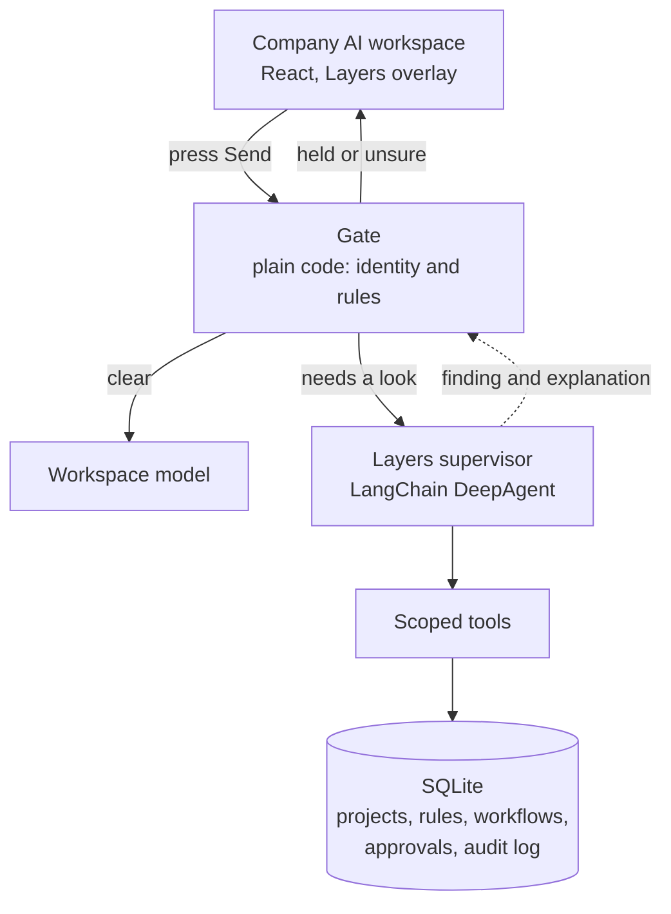

# Layers

An intelligent management layer for a company's AI workspace. AI does the work; Layers manages the work.

Built at HackPrinceton, November 13 to 15, 2026. Track: Business and Enterprise.

## What it does

An employee works in the company's AI chat. Layers checks each prompt when they press Send:

- **On project:** it goes straight through, and Layers stays quiet.
- **Off project:** it is held. Layers names the rule, shows the words that triggered it, and offers a way back or a request to the manager.
- **Already built:** if the team has an approved workflow for the request, Layers offers it and, on a click, applies it to the project.
- **Not sure:** Layers says so, shows what counted each way, and follows the company's choice: ask the employee, let it through and log it, or hand it to a person.

The employee can also ask Layers a question before sending anything, move it, hide it, and change how it looks.

## How it works



- **The gate enforces.** `server/policy.py` and the checks inside each tool decide what is allowed. `/api/chat` refuses any prompt without an allowing decision on record.
- **The agent proposes and explains.** `server/agent.py` is one `create_deep_agent` call with these tools: `get_project_context`, `check_company_policy`, `search_org_memory`, `check_access`, `create_project_artifact`, `update_task_status`, `request_manager_approval`, `submit_verdict`, and a `knowledge-scout` subagent. It cannot clear a prompt the rules flagged.
- **The harness pauses for a person.** `create_project_artifact` is listed in `interrupt_on`, so DeepAgents stops the agent before anything is created and holds the run in a checkpointer. The employee's click resumes it.
- **A person approves.** Only the manager endpoint can approve a held prompt.
- **It adapts.** When the employee explains how a prompt connects to the project, Layers remembers the distinctive words and stops flagging that kind of request. No model is trained.
- **Everything is logged.** Each tool call is timed, shown to the employee in plain English, and written to the audit log.

## Run it

```bash
python3 -m venv .venv && .venv/bin/pip install -r requirements.txt
npm --prefix web install
cp .env.example .env        # optional: add a model and key
.venv/bin/python -m uvicorn server.main:app --host 127.0.0.1 --port 8000
npm --prefix web run dev    # in a second terminal, then open http://localhost:5173
```

Without a model key the server runs on rules alone and the interface says so. Without the server the interface falls back to a scripted preview and says so.

Check the agent wiring without a key: `.venv/bin/python -m tests.test_agent_wiring`

## What is real and what is not

| | |
|---|---|
| Real | The gate, the tools, the database, approvals, the audit log, the adaptive word list, the DeepAgents harness (tested with a stand-in model) |
| Needs a model key | The agent's own judgment on unclear prompts, and answers from the workspace model |
| Seeded | The company, people, project, rules and workflows are fictional demo data |
| Not built | Integration with ChatGPT or other tools, a manager inbox, real accounts and sign-in |

No time or money savings are claimed. The only numbers shown are counts and tool timings measured in the session.

## Privacy and safety

- Layers reads a prompt only when the employee presses Send in this workspace, and the page says so.
- It never deletes a draft. Every intervention can be undone or appealed.
- The employee's identity is fixed on the server; no tool takes it from the model or the browser.
- The agent has no shell and no access to real files. Keys live in `.env`, which is not committed.
